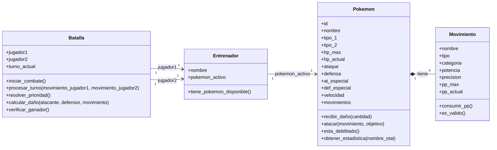

# Simulador de batallas Pokémon 1 vs. 1

Proyecto de consola en Python que simula un combate entre dos entrenadores. Cada uno elige un Pokémon y, en cada turno, selecciona uno de sus movimientos. El motor resuelve el orden de ataque, la precisión, el daño y el resultado del combate.

## Cómo ejecutar

Desde esta carpeta (`taller4`), ejecuta:

```powershell
python main.py
```

El programa solicita el nombre de cada jugador, permite elegir un Pokémon del pool y luego inicia el combate. En cada turno muestra los HP y PP, y solicita primero el movimiento del Jugador 1 y luego el del Jugador 2.

Para ejecutar las pruebas:

```powershell
python -m unittest discover -s tests -v
```

## Qué incluye

- **Datos (`data/`):** catálogo de movimientos, matriz de efectividad de tipos y pool de 20 Pokémon que cubre los 18 tipos.
- **Modelos (`models/`):** clases `Movimiento`, `Pokemon` y `Entrenador`. Cada entrenador tiene un solo Pokémon activo.
- **Motor (`engine/`):** clase `Batalla`, que coordina los turnos, determina la prioridad, delega el cálculo del daño y verifica al ganador.
- **Interfaz (`cli/`):** selección de Pokémon y movimientos, HUD de HP/PP, validación de entradas y ciclo del combate.
- **Entrada (`main.py`):** conecta la selección de jugadores con el motor y la interfaz.
- **Pruebas (`tests/`):** verificaciones de datos, modelos, motor de batalla y flujo de consola.

El pool se define en `data/pokemon_pool.py`; `data/pool.json` no es la fuente usada por el programa.

## Mecánicas implementadas

- Prioridad para el Pokémon más veloz; los empates se resuelven al azar.
- Precisión de los movimientos y consumo de PP, incluso si el movimiento falla.
- Probabilidad de crítico de 1/16 y modificador de daño aleatorio entre 0.85 y 1.00.
- Daño físico o especial según la categoría del movimiento.
- STAB, efectividad por tipo y combinación de efectividad para defensores de dos tipos.
- El daño se limita a los HP restantes; al debilitarse un Pokémon, no realiza su ataque de ese turno.

Si un Pokémon se queda sin PP en todos sus movimientos, la interfaz termina la batalla sin ganador. El programa no guarda el estado de combates anteriores: al elegir un Pokémon se crea una instancia independiente del pool.

## Diagrama de entidades

El diagrama editable también está disponible en [`diagrama_entidades.mmd`](./diagrama_entidades.mmd).



La función de cálculo de daño es una función de módulo en `models/pokemon.py`; `Pokemon.atacar()` la utiliza y aplica el daño al objetivo. La efectividad se consulta en `data/matriz_efectividad.py`.

## Guía breve para explicar el diseño

1. **Datos:** el pool reúne los Pokémon y sus movimientos; la matriz define las relaciones de efectividad entre tipos.
2. **Objetos:** `Movimiento` administra sus PP; `Pokemon` contiene estadísticas y estado de combate; `Entrenador` representa a cada participante.
3. **Motor:** `Batalla` decide el orden de las acciones, ejecuta ambos movimientos y detecta el final del combate. Las reglas de daño se aplican desde el modelo `Pokemon`.
4. **Consola:** `main.py` prepara a los jugadores; la interfaz muestra el estado, valida las elecciones y vuelve a solicitar entradas inválidas.

## Estado de las fases

- **Fases 1–3:** implementadas según la hoja de ruta.
- **Fase 4.1–4.3:** HUD, selección de comandos y validación de entradas implementados.
- **Fase 4.4:** hay pruebas de los enfrentamientos de ejemplo y del flujo completo. La comparación independiente de todas las cifras con el PDF del proyecto aún debe confirmarse.

La cobertura de pruebas ejecutada durante el desarrollo fue de 18 pruebas con `unittest`.
